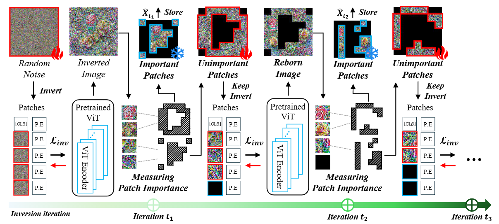

# Patch Rebirth: Fast and Transferable Model Inversion of Vision Transformers

**NeurIPS 2026**

**Seongsoo Heo and Dong-Wan Choi**

Inha University

Official implementation of **Patch Rebirth Inversion (PRI)**, a model inversion method that synthesizes transferable images from pretrained Vision Transformers without access to the original training data.

## Overview

**TL;DR:** Instead of discarding less informative patches, PRI progressively saves informative patches as sparse images and continues optimizing the remaining patches, producing multiple synthetic images in a single inversion run.

Dense Model Inversion (DMI) optimizes every image patch throughout synthesis, making inversion expensive for Vision Transformers. Sparse Model Inversion (SMI) reduces this cost by pruning patches considered unimportant. Our study shows that even initially uninformative patches can acquire transferable knowledge if inversion continues.

PRI builds on this **Re-Birth effect**: at each detachment step, it stores the most informative patches as a sparse image and lets the remaining patches develop new class-relevant features. The resulting images capture complementary class-agnostic and class-specific knowledge for data-free knowledge transfer and quantization.

<p align="center">
  
</p>

### Highlights

- **Multiple outputs from one inversion run.** Progressively detach and store informative patches rather than permanently discard less informative ones.
- **Controllable sparsity.** A division factor of 4 produces four sparse images per initialized image, each with 75% sparsity.
- **Efficient inversion.** The paper reports up to **10x faster inversion than DMI** and **2x faster inversion than SMI** in experiments on a single NVIDIA RTX A6000. These are inversion speedups, not inference speedups.
- **Data-free downstream tasks.** Evaluate the synthesized images through knowledge transfer on CIFAR-10, CIFAR-100, and Tiny-ImageNet, and quantization on ImageNet-1k.

## Repository Structure

| Path | Description |
| --- | --- |
| `synthesis/pri.py` | PRI synthesis, patch selection, and progressive detachment. |
| `utils/build_model.py` | ViT forward-pass adaptations for sparse patch processing. |
| `utils/data_utils.py` | Dataset loading, preprocessing, and sparse-image utilities. |
| `quantization/` | Quantized ViT layers and models. |
| `test_kt.py` | Data-free knowledge transfer experiment entry point. |
| `test_quant.py` | Data-free quantization experiment entry point. |

## Setup

```bash
git clone https://github.com/bigdata-inha/PRI.git
cd PRI
```

The code requires Python, a CUDA-capable GPU, and a CUDA-compatible installation of **PyTorch** and **torchvision**. Additional dependencies imported by the code are:

```bash
pip install timm numpy Pillow tqdm pandas scikit-learn matplotlib
```

A pinned environment file and `requirements.txt` are not included in this snapshot; package versions should be checked against the model APIs used by the code.

### Data and Checkpoints

- **Knowledge transfer:** provide a teacher checkpoint named `<model>.pth` in the directory passed to `--model_path`. For example, the CIFAR-100 DeiT-Base configuration expects `deit_base_16_cifar100.pth`. Teacher checkpoints are not included in this repository.
- **CIFAR-10 / CIFAR-100:** `--dataset` specifies the dataset root. The loader downloads the dataset if needed.
- **Tiny-ImageNet:** prepare `train` and `val` directories with one subdirectory per class, as expected by `torchvision.datasets.ImageFolder`.
- **ImageNet-1k:** prepare the validation data and required devkit metadata in the format expected by `torchvision.datasets.ImageNet`. ImageNet-pretrained model weights are loaded by the model builders.

PRI synthesizes images without using original training samples. The experiment scripts use real validation or test data to measure downstream accuracy; the CIFAR loaders also initialize the training split, although it is not used for synthesis or student updates.

## Experiments

> **Before running:** the current entry points require the source-level fixes described in [Current Release Notes](#current-release-notes). The commands below document the intended experiment configurations; they are not an out-of-the-box reproduction setup.

Both examples use the default **4,000 inversion iterations** and **division factor of 4**. Commands use Bash syntax.

### Data-Free Knowledge Transfer

Transfer knowledge from a CIFAR-100 DeiT-Base teacher to a student with an ImageNet-pretrained backbone and a newly initialized classifier. The current script updates only the student's classifier.

```bash
python test_kt.py \
  --gpu 0 \
  --model deit_base_16_cifar100 \
  --dataset dataset \
  --model_path model \
  --datapool inverted_data \
  --kr-batchsize 128 \
  --epoches 1000
```

The entry point includes DeiT-Tiny, DeiT-Small, and DeiT-Base configurations for CIFAR-10, CIFAR-100, and Tiny-ImageNet. Synthesized images are stored under `--datapool`.

### Data-Free Quantization

Generate synthetic calibration images and optimize a quantized DeiT-Tiny model on ImageNet-1k. This example uses **8-bit weights and 8-bit activations**.

```bash
python test_quant.py \
  --gpu 0 \
  --model deit_tiny_16_imagenet \
  --dataset imagenet \
  --datapool inverted_data_q \
  --calib-batchsize 128 \
  --g_epoches 79 \
  --t_epoches 100 \
  --mode 0 \
  --w_bit 8 \
  --a_bit 8
```

The quantization entry point includes DeiT-Tiny, DeiT-Small, and DeiT-Base configurations. `--w_bit` and `--a_bit` control weight and activation precision, respectively.

### Current Release Notes

Known issues in the current source snapshot:

- **Synthesizer imports:** `synthesis` exports `pri`, but `test_kt.py` imports `PRI` and `test_quant.py` imports `PMI`. The entry points and their constructor calls need to use the exported name consistently.
- **Argument types:** `--iterations` and `--div` use `nargs='+'`, which produces lists when these flags are supplied, while synthesis expects scalar integers. The examples above omit these flags to retain their integer defaults. The parser must be corrected before overriding them.
- **Python 3.14 compatibility:** literal percentage signs in the `--div` help text cause parser initialization to fail. They need to be escaped as `%%` for `argparse` help formatting.

## Citation

If you find this work useful in your research, please cite:

```bibtex
@inproceedings{heo2026patchrebirth,
  title     = {Patch Rebirth: Fast and Transferable Model Inversion of Vision Transformers},
  author    = {Heo, Seongsoo and Choi, Dong-Wan},
  booktitle = {Advances in Neural Information Processing Systems},
  year      = {2026}
}
```

## Acknowledgments

We acknowledge the following prior work and its contributions to data-free learning:

- **DeepInversion:** Dreaming to Distill: Data-Free Knowledge Transfer via DeepInversion.
- **CMI:** Contrastive Model Inversion for Data-Free Knowledge Distillation.
- **PSAQ-ViT:** Patch Similarity Aware Data-Free Quantization for Vision Transformers.
- **SMI:** [Sparse Model Inversion: Efficient Inversion of Vision Transformers for Data-Free Applications](https://openreview.net/forum?id=T0lFfO8HaK).

## License

This repository is released under the [MIT License](LICENSE).
